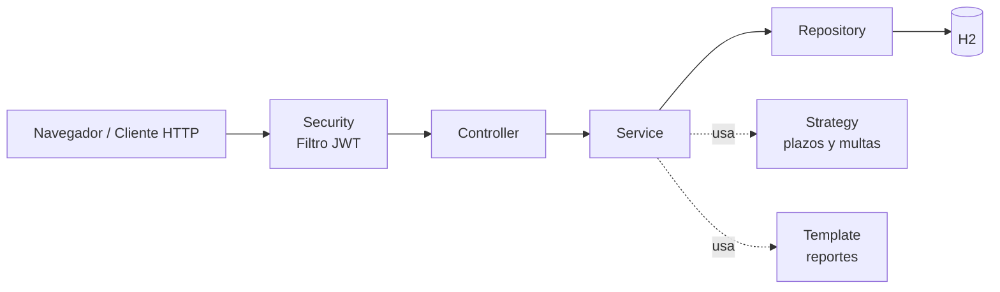

# 🖥️ Sistema de Préstamos de Equipos Tecnológicos


Aplicación web para gestionar el préstamo de **notebooks, proyectores y tablets** de una universidad. Controla el inventario, los solicitantes, las devoluciones, los vencimientos y las multas, con una **API REST** protegida con JWT y una **interfaz web** que cambia según el rol de cada usuario.

## Índice

- [Características](#características)
- [Tecnologías](#tecnologías)
- [Arquitectura](#arquitectura)
- [Roles y permisos](#roles-y-permisos)
- [Perfiles, plazos y multas](#perfiles-plazos-y-multas)
- [Puesta en marcha](#puesta-en-marcha)
- [Interfaz web](#interfaz-web)
- [Autenticación](#autenticación)
- [Endpoints de la API](#endpoints-de-la-api)
- [Reglas de negocio](#reglas-de-negocio)
- [Códigos de respuesta](#códigos-de-respuesta)
- [Estructura del proyecto](#estructura-del-proyecto)
- [Limitaciones y mejoras pendientes](#limitaciones-y-mejoras-pendientes)
- [Autores](#autores)

## Características

- Autenticación con **JWT** sin sesiones en el servidor, con cierre de sesión que revoca el token.
- Tres roles (`ADMIN`, `ENCARGADO`, `USER`) y tres perfiles de solicitante (`ALUMNO`, `DOCENTE`, `STAFF`).
- Inventario de equipos con estados `DISPONIBLE`, `PRESTADO` y `EN_REPARACION`.
- Registro y devolución de préstamos con **validación de disponibilidad**.
- **Cálculo automático** de vencimiento y multa según el perfil (patrón *Strategy*).
- Reportes de préstamos **vencidos, activos e historial**, con exportación a **CSV** (patrón *Template Method*).
- Errores HTTP estandarizados para validaciones y conflictos de negocio.
- Interfaz web en HTML, CSS y JavaScript, servida por la propia aplicación.
- Documentación interactiva con **Swagger UI**.

## Tecnologías

| Tecnología | Uso |
|---|---|
| Java 21 | Lenguaje |
| Spring Boot | Framework principal |
| Spring Web | Endpoints REST |
| Spring Data JPA + Hibernate | Persistencia |
| Spring Security | Autenticación y autorización |
| JWT (JJWT) | Generación y validación de tokens |
| BCrypt | Hash de contraseñas |
| H2 Database | Base de datos en memoria |
| OpenAPI / Swagger UI | Documentación interactiva |
| Maven | Dependencias y construcción |
| HTML + CSS + JavaScript | Interfaz web (sin dependencias externas) |

## Arquitectura

Aplicación monolítica organizada en capas:



| Capa | Responsabilidad |
|---|---|
| `controller` | Recibe las solicitudes HTTP y devuelve las respuestas |
| `service` | Reglas y operaciones de negocio |
| `repository` | Acceso a datos con JPA |
| `model` | Entidades y enumeraciones del dominio |
| `dto` | Datos que recibe y devuelve la API |
| `security` | Spring Security, filtro JWT y reglas de acceso |
| `strategy` | Políticas de plazo y multa por perfil |
| `template` | Estructura común para generar reportes |

## Roles y permisos

| Rol | Responsabilidades |
|---|---|
| `ADMIN` | Gestionar equipos (alta, cambio de estado, baja) y asignar perfiles a los solicitantes. También consulta préstamos y reportes. |
| `ENCARGADO` | Registrar préstamos y devoluciones. Consulta equipos, solicitantes y reportes. |
| `USER` | Consultar equipos y sus propios préstamos. |

El registro público crea usuarios con rol `USER` y perfil `ALUMNO`. El cliente **no puede** asignarse el rol `ADMIN` desde el registro.

## Perfiles, plazos y multas

| Perfil | Plazo | Multa por demora |
|---|---|---|
| `ALUMNO` | 3 días | $500 por cada día de atraso |
| `DOCENTE` | 7 días | $2.000 fijos si existe atraso |
| `STAFF` | 7 días | Sin multa |

El sistema elige la política según el perfil del solicitante. Al devolver un equipo calcula los días de retraso, determina la multa y actualiza el estado del préstamo y del equipo.

## Puesta en marcha

**Requisitos:** JDK 21. Maven no hace falta instalarlo porque el proyecto incluye Maven Wrapper.

```bash
# Windows
.\mvnw.cmd spring-boot:run

# Linux / macOS
./mvnw spring-boot:run
```

Para compilar el proyecto: `./mvnw clean package`.

La aplicación queda disponible en `http://localhost:8080`.

| Recurso | URL |
|---|---|
| Interfaz web | http://localhost:8080/ |
| Swagger UI | http://localhost:8080/swagger-ui/index.html |
| OpenAPI JSON | http://localhost:8080/v3/api-docs |
| Consola H2 | http://localhost:8080/h2-console |

### Datos de prueba

Al iniciar se cargan usuarios, cinco equipos y un préstamo vencido del equipo `NB-003`, para probar la devolución y el cálculo de multas.

| Usuario | Contraseña | Rol |
|---|---|---|
| `admin` | `Admin12345!` | `ADMIN` |
| `encargado` | `Encargado123!` | `ENCARGADO` |
| `alumno` | `alumno123` | `USER` |
| `docente` | `docente123` | `USER` |

> Son credenciales de demostración. Cambialas o eliminá `DatosDemo` antes de cualquier uso real.

## Interfaz web

La interfaz está en `src/main/resources/static/index.html` y se sirve en la raíz (`/`). Está hecha con HTML, CSS y JavaScript puro, sin frameworks, y consume la API con `fetch`.

- **Acceso:** inicio de sesión y creación de cuenta.
- **Menú según rol:** cada usuario ve solo las secciones que le corresponden.
- **Inicio:** resumen de inventario, préstamos activos y vencidos.
- **Equipos:** tarjetas con búsqueda, filtro por tipo y por disponibilidad. El `ADMIN` puede registrar, cambiar estado y eliminar.
- **Préstamos:** el `ENCARGADO` registra préstamos y devoluciones, y ve la multa al devolver.
- **Solicitantes:** listado y cambio de perfil (`ADMIN`).
- **Reportes:** vista en pantalla y descarga CSV.
- **Mis préstamos y perfil:** para el rol `USER`.

## Autenticación

La API es *stateless* y usa JWT. El token dura **1 hora**.

1. `POST /api/auth/signin` devuelve el token junto con el usuario y su rol.
2. Para los endpoints protegidos se envía el encabezado:

```http
Authorization: Bearer <token>
```

3. `POST /api/auth/logout` revoca el token. El filtro comprueba en cada solicitud que no esté revocado.

Ejemplo:

```bash
curl -X POST http://localhost:8080/api/auth/signin \
  -H "Content-Type: application/json" \
  -d '{"username":"encargado","password":"Encargado123!"}'
```

## Endpoints de la API

### Autenticación

| Método | Endpoint | Descripción | Acceso |
|---|---|---|---|
| `POST` | `/api/auth/signup` | Registra una cuenta (rol `USER`, perfil `ALUMNO`) | Público |
| `POST` | `/api/auth/signin` | Inicia sesión y devuelve un JWT | Público |
| `GET` | `/api/auth/me` | Datos de la sesión actual | Autenticado |
| `POST` | `/api/auth/logout` | Revoca el token actual | Autenticado |

### Equipos

| Método | Endpoint | Descripción | Rol previsto |
|---|---|---|---|
| `GET` | `/equipos?soloDisponibles=true` | Lista los equipos, con filtro opcional | Todos |
| `GET` | `/equipos/{id}` | Detalle de un equipo | Todos |
| `POST` | `/equipos` | Registra un equipo | `ADMIN` |
| `PUT` | `/equipos/{id}/estado` | Cambia el estado del equipo | `ADMIN` |
| `DELETE` | `/equipos/{id}` | Elimina un equipo | `ADMIN` |

### Solicitantes

| Método | Endpoint | Descripción | Rol previsto |
|---|---|---|---|
| `GET` | `/solicitantes` | Lista los solicitantes | `ADMIN`, `ENCARGADO` |
| `GET` | `/solicitantes/me` | Solicitante de la sesión actual | Todos |
| `GET` | `/solicitantes/{id}` | Detalle de un solicitante | `ADMIN`, `ENCARGADO` |
| `PUT` | `/solicitantes/{id}/perfil` | Asigna `ALUMNO`, `DOCENTE` o `STAFF` | `ADMIN` |

### Préstamos

| Método | Endpoint | Descripción | Rol previsto |
|---|---|---|---|
| `GET` | `/prestamos` | Lista los préstamos activos | `ADMIN`, `ENCARGADO` |
| `GET` | `/prestamos/mios` | Préstamos del usuario autenticado | Todos |
| `POST` | `/prestamos/solicitar` | Registra un préstamo (`solicitanteId`, `equipoId`) | `ENCARGADO` |
| `POST` | `/prestamos/{id}/devolver` | Registra la devolución y calcula la multa | `ENCARGADO` |

### Reportes

| Método | Endpoint | Descripción |
|---|---|---|
| `GET` | `/reportes` | Lista las claves de reportes disponibles |
| `GET` | `/reportes/{clave}` | Devuelve el reporte en JSON (`titulo`, `encabezados`, `filas`) |
| `GET` | `/reportes/{clave}/csv` | Descarga el reporte en CSV |

Claves disponibles: `vencidos`, `activos` e `historial`.

## Reglas de negocio

- Solo se puede prestar un equipo en estado `DISPONIBLE`.
- Al registrar el préstamo, el equipo pasa a `PRESTADO` y el préstamo queda `ACTIVO` con su fecha de vencimiento calculada según el perfil.
- Al devolverlo, el préstamo pasa a `DEVUELTO` y el equipo vuelve a `DISPONIBLE`.
- Un préstamo no se puede devolver dos veces.
- Cada préstamo corresponde a un único equipo.

## Códigos de respuesta

| Código | Significado | Situación habitual |
|---|---|---|
| `400` | Solicitud inválida | Faltan campos o los datos no son válidos |
| `401` | No autenticado | No se envió token o el token es inválido, está vencido o fue revocado |
| `403` | Acceso denegado | El rol no tiene permiso para la operación |
| `404` | No encontrado | No existe el equipo, préstamo o solicitante |
| `409` | Conflicto | Equipo ya prestado, préstamo ya devuelto o código repetido |

## Estructura del proyecto

```
src/main
├── java/com/proyecto/prestamos
│   ├── config/        Configuración de OpenAPI
│   ├── controller/    Endpoints REST y manejo de errores
│   ├── dto/           Objetos de entrada y salida
│   ├── model/         Entidades y enumeraciones
│   ├── repository/    Repositorios JPA
│   ├── security/      JWT, filtro y reglas de acceso
│   ├── service/       Lógica de negocio y datos iniciales
│   ├── strategy/      Políticas de plazo y multa
│   └── template/      Generación de reportes
└── resources
    ├── application.properties
    └── static/index.html     Interfaz web
```

## Limitaciones y mejoras pendientes

- **Autorización por rol:** la configuración actual solo restringe por rol el cambio de perfiles (`ADMIN`). El resto de los permisos de la tabla anterior los aplica la interfaz, por lo que conviene reforzarlos en `WebSecurityConfig` con reglas `hasRole(...)` por ruta.
- **Concurrencia:** no hay control para impedir que dos operaciones simultáneas presten el mismo equipo (por ejemplo, con bloqueo optimista).
- **Persistencia:** H2 en memoria pierde los datos al reiniciar. Para producción, usar una base de datos persistente.
- **Secretos:** mover `jwt.secret` y las credenciales a variables de entorno.
- **Pruebas:** agregar pruebas automatizadas.

## Autores

Proyecto desarrollado por **Gauna** y **Leiva**.
